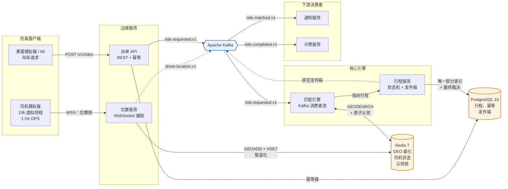
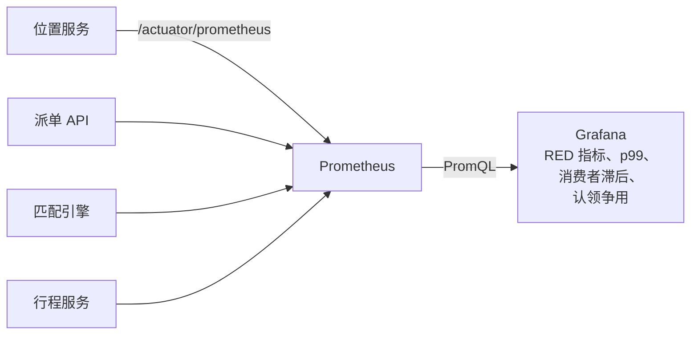
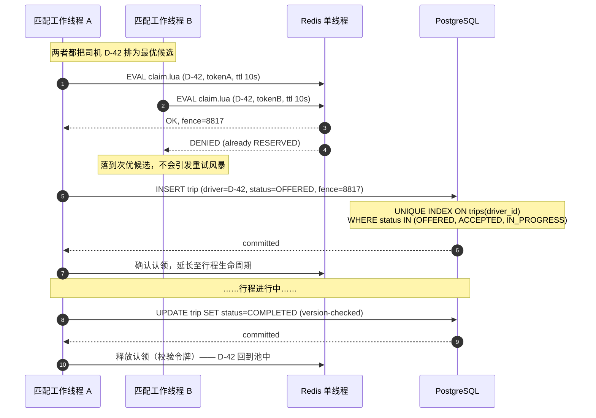
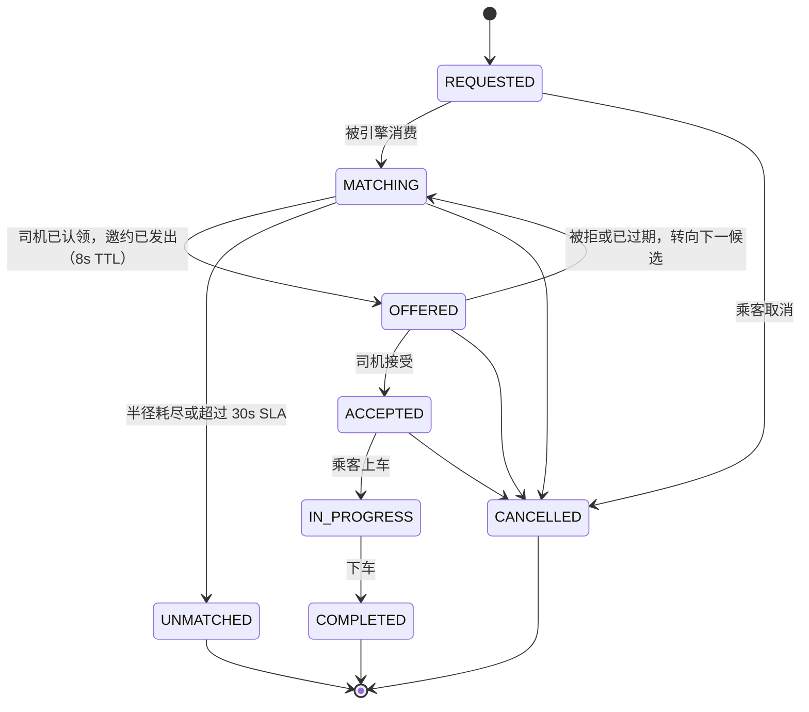

# 实时叫车匹配引擎（Real-Time Ride-Matching Engine）

一个用 **Java 25** 构建的、具备生产形态的事件驱动派单后端：它通过 WebSocket 摄取数千名司机的高频 GPS
流，在 Redis 中建立地理空间索引，并把乘客匹配到最近的可用司机——**保证任何司机都不会被同时指派给两个行程**，
即使面对数千个并发请求也是如此。

没有用户界面。交付物就是系统本身：架构、并发保证、Kafka 拓扑，以及证明它经得起考验的压测证据。

| | |
|---|---|
| **语言 / 运行时** | Java 25 LTS（虚拟线程），Spring Boot 4.1 |
| **地理空间索引** | Redis 7（`GEOADD` / `GEOSEARCH`）|
| **记录系统** | PostgreSQL 16 |
| **事件主干** | Apache Kafka（KRaft）|
| **可观测性** | Micrometer → Prometheus → Grafana，OpenTelemetry 链路追踪 |
| **测试** | JUnit 5、Testcontainers、k6 负载测试工具 |
| **基础设施** | Podman + Dev Containers——宿主机无需 JDK、Maven 或数据库 |

---

## 目标 SLO

这些是系统设计与压测所依据的数字，而非愿景：

| 指标 | 目标 |
|---|---|
| 位置摄取吞吐量 | 10,000 updates/sec（10k 司机 @ 1 Hz）|
| 位置摄取延迟（p99）| < 50 ms |
| 叫车请求 → 司机匹配完成（p99）| < 500 ms |
| 叫车请求 API 延迟（p99）| < 120 ms（仅入队；匹配为异步）|
| 重复指派率 | **0** —— 由结构保证，而非靠概率 |
| 持续叫车请求 | 500 req/sec |

---

## 系统架构



指标与链路追踪是一个独立的平面，刻意从上面的数据流图中排除出去：



**一段话讲完流程。** 司机保持一条 WebSocket 连接，每秒推送一帧 GPS。位置服务把这些帧以管道方式写入 Redis
地理空间索引（并镜像到一条短保留期的 Kafka 主题上供分析使用）——这条路径完全不触碰 Postgres。乘客发起一次叫车请求
POST；派单 API 校验幂等键、持久化该请求，并立即返回 `202 Accepted`。匹配引擎从 Kafka 消费这条请求，
执行 `GEOSEARCH` 找出半径内的候选司机，排序后尝试对最优候选进行**原子认领**。行程服务把指派结果写入
Postgres，那里的唯一部分索引使重复指派在物理上不可能发生。随后产生的 `ride.matched` 事件经由事务性发件箱
（transactional outbox）扇出到通知与计费服务，这两者与请求路径完全解耦。

---

## 三大难题

### 1. 写入密集负载下的地理空间索引

10,000 名司机以 1 Hz 上报就是每秒 10,000 次写入——这种负载会让依赖 B-tree 与 vacuum 的数据库苦不堪言。
Redis 的 `GEOADD` 是对 52 位 geohash 的一次有序集合插入：O(log N)、纯内存、没有写放大。
`GEOSEARCH ... BYRADIUS 3.2 km ASC COUNT 20` 能在亚毫秒级时间内返回排好序的候选司机。

写入量还在边缘侧进一步削减：只有当司机移动超过 25 m，或距离上次写入已过 3 s 时，位置帧才会被持久化，
而且写入以批量管道方式执行。PostGIS 保留在设计之中，只用于它真正擅长的事情——地理围栏、区域分析、
历史行程查询——而不是热点路径。
→ [ADR-0002](docs/adr/0002-redis-geo-over-postgis.md)

### 2. 并发：绝不让一名司机被指派给两个行程

这是项目的核心，它通过**两层**机制解决，而不是依赖一把锁：



- **第 1 层 —— Redis Lua CAS（快速路径）。** 单个 Lua 脚本对司机的状态哈希执行比较并设置
  （compare-and-set）。Redis 在单线程上原子地执行脚本，因此检查与写入不可能交错。落败方在一次
  往返内即被拒绝，并立刻转向下一个候选，而不是空转重试。
- **第 2 层 —— Postgres 唯一部分索引（真正的保证）。** `UNIQUE (driver_id) WHERE
  status IN ('OFFERED','ACCEPTED','IN_PROGRESS')`。即便 Redis 丢失了状态、锁在半途过期，
  或网络分区把各个工作线程隔开，数据库也*不可能*为同一名司机存下两个进行中的行程。
  正确性存在于持久状态所在之处。
- **围栏令牌（fencing token）。** 每次认领都携带一个单调递增的 `INCR` 令牌。因停顿超过租约而
  晚醒的工作线程写入的是过期令牌，会被拒绝——这正是普通分布式锁会默许的失效模式。
- **释放，以及其后的对账器。** 认领一旦成立就等于把司机移出了池子，因此每个终态转换都必须把他交还。
  释放发生在 Postgres 提交*之后*，绝不会在此之前——由持久化写入说了算。这个顺序留下一个窗口：
  中途崩溃时什么都不会被释放，而且已被接受的行程其认领的 TTL 已被移除，不会有任何过期机制去清理它。
  一个后台对账器（reconciler）通过释放 Postgres 认为没有任何行程持有的认领来补上这个窗口。
  它只会*从* Postgres 同步到 Redis，绝不做反向同步，因为只有这个方向才可能正确。

**关于 Redlock：** 刻意不使用。Redlock 的安全性论证依赖有界的时钟漂移和有界的 GC 停顿，而且它对
"持有者仍在工作期间租约却已过期"这种情况毫无保护（见 Kleppmann 的批评）。把 Redis 认领视为
*降低争用的优化手段*、把数据库约束视为*正确性边界*，才是诚实的设计。
→ [ADR-0004](docs/adr/0004-driver-claim-concurrency.md)

### 3. 事件驱动解耦而不丢事件

请求路径只发布然后返回；匹配、通知和计费都发生在关键路径之外。Kafka 的投递是**至少一次
（at-least-once）**，因此每个消费者都被设计为幂等（按事件 ID 去重）——绝不宣称系统实际并不具备的
恰好一次语义。

向 Kafka 生产消息与向 Postgres 提交事务无法成为一次原子操作，因此改变状态的事件都经过
**事务性发件箱（transactional outbox）**：行程写入与发件箱行一起提交，再由一个发布器排空发件箱。
既不丢事件，也不产生幻影事件。
→ [ADR-0003](docs/adr/0003-kafka-topology-and-outbox.md)

**主题拓扑**

| 主题 | 键 | 分区数 | 保留期 | 用途 |
|---|---|---|---|---|
| `driver.location.v1` | `driverId` | 12 | 1 h | 遥测镜像 / 分析 |
| `ride.requested.v1` | `rideId` | 12 | 7 d | 匹配引擎的工作队列 |
| `ride.matched.v1` | `rideId` | 12 | 7 d | 扇出到通知 + 计费 |
| `ride.unmatched.v1` | `rideId` | 6 | 7 d | 在 SLA 窗口内未找到司机 |
| `ride.completed.v1` | `rideId` | 12 | 7 d | 计费触发 |
| `ride.cancelled.v1` | `rideId` | 6 | 7 d | 通知服务不予派发；不计车费 |
| `*.dlt` | — | 3 | 30 d | 重试耗尽后的死信 |

以 `rideId` 作为键保证了每个行程内的顺序；以 `driverId` 作为位置的键保证了司机的位置序列
永远不会被打乱重排。

---

## 幂等性

`POST /v1/rides` 要求携带 `Idempotency-Key` 请求头。该键、请求体的哈希值以及最终响应会存入
Postgres，并带有 24 小时的 TTL：

| 情形 | 响应 |
|---|---|
| 首次使用此键的请求 | `202 Accepted`，任务已入队 |
| 重试，原请求仍在处理中 | `409 Conflict` + `Retry-After` |
| 重试，原请求已完成 | `200 OK` —— 重放**已存储**的原始响应 |
| 相同键，*不同*的请求体 | `422 Unprocessable Entity` —— 键被复用属于客户端缺陷 |

插入使用的是 `INSERT ... ON CONFLICT DO NOTHING`，因此两个并发重试之间的竞争由数据库裁决，
而不是靠"先读后写"的检查——那种检查在两次操作之间存在时间窗口。
→ [ADR-0005](docs/adr/0005-idempotency.md)

---

## 行程生命周期



每一次转换都在服务端受到守护，非法转换会被拒绝而不是被默默容忍：转换表只在 `TripStatus` 中
声明一次，聚合根也没有可以绕开它的状态 setter。`IN_PROGRESS` 刻意没有任何通往 `CANCELLED`
的路径——中止一段已经在途的行程属于另一套业务流程，有它自己的车费影响，而不是一次取消。

并非每次转换都发布事件。`ride.completed.v1` 和 `ride.cancelled.v1` 走发件箱，因为计费与通知
会对它们做出处理；`accept` 与 `start` 只记录到只追加的 `trip_events` 轨迹中，仅此而已，
因为不存在会读取它们的消费者。发布一个无人订阅的主题，等于白白承担一份需要长期维护的契约。

`trip-service` 通过 HTTP 暴露这些转换，与叫车请求的创建相互独立：

| | |
|---|---|
| `POST /v1/rides`（`:8080`）| 创建行程。返回 `202` —— 匹配是异步的。 |
| `POST /v1/trips/{id}/accept`（`:8083`）| 司机接受邀约。为整段行程固定住 Redis 认领。 |
| `POST /v1/trips/{id}/start` | 乘客已上车。 |
| `POST /v1/trips/{id}/complete` | 下车。终态；释放司机。 |
| `POST /v1/trips/{id}/cancel` | 取消行程。终态；释放司机。进入 `IN_PROGRESS` 后将被拒绝。 |
| `GET /v1/trips/{id}` | 当前状态与已指派的司机。 |

生命周期调用是同步的，而叫车请求的创建不是。司机点击*接受*时需要立刻知道是否已被别人抢先；
乘客发起叫车时则不必让连接一直保持打开等引擎搜索。并发转换由乐观版本检查（optimistic version
check）仲裁，落败方收到 `409` 加 `Retry-After`。

---

## 仓库结构

六边形架构（端口与适配器）——领域逻辑零框架依赖，无需运行 Redis、Kafka 或 Postgres 即可做
单元测试。

```
ride-matching-engine/
├── .devcontainer/               # JDK 25 + Maven sandbox (VS Code attaches here)
├── docs/
│   ├── ARCHITECTURE.md          # deep system design
│   ├── LOAD_TESTING.md          # methodology + results
│   └── adr/                     # architecture decision records
├── services/
│   ├── location-service/        # WebSocket ingestion -> Redis GEO
│   ├── dispatch-api/            # REST, idempotency, request intake
│   ├── matching-engine/         # Kafka consumers, ranking, claims
│   ├── trip-service/            # trip state machine, Postgres, outbox
│   ├── notification-service/    # downstream consumer (decoupling proof)
│   └── billing-service/         # downstream consumer (fan-out proof)
├── libs/
│   ├── domain/                  # pure domain model + ports (no Spring)
│   ├── events/                  # versioned event schemas
│   ├── platform/                # observability, outbox, Kafka/Redis config
│   └── schema/                  # Flyway migrations (shared: two services write these tables)
├── simulator/                   # driver + rider simulation harness
├── loadtest/                    # k6 scenarios
├── ops/
│   ├── docker-compose.yml
│   ├── prometheus/
│   └── grafana/                 # provisioned dashboards (committed as JSON)
└── README.md
```

每个服务模块内部结构如下：

```
domain/          entities, value objects, invariants  — no frameworks
application/     use cases, port interfaces           — orchestration only
adapters/in/     REST controllers, WS handlers, Kafka consumers
adapters/out/    Redis, Postgres, Kafka producer implementations
```

→ [ADR-0001](docs/adr/0001-hexagonal-architecture.md)

---

## 可观测性

每个服务都暴露 `/actuator/prometheus`。已提交的 Grafana 仪表盘追踪以下指标：

仪表盘以 JSON 形式提交并自动预配置，因此评审者看到的面板就是压测评判所依据的面板——
而不是事后手工重建出来的东西。

- **RED 指标**按端点统计——速率、错误、耗时（p50 / p95 / p99）
- `matching_duration_seconds` —— 从请求到匹配的端到端直方图
- `match_success_ratio` 与 `match_attempts_per_ride` —— 派单质量
- `driver_claim_contention_total` —— 两个工作线程盯上同一名司机的频率
- 每个消费者组的 `kafka_consumer_lag` —— 真正的背压信号
- `redis_geo_query_duration_seconds`，以及按状态划分的活跃司机池大小

结构化 JSON 日志携带贯穿 HTTP → Kafka → 消费者的链路追踪 ID，因此单次行程可以端到端地还原。

---

## 压力测试

`loadtest/` 用 k6 驱动系统，同时模拟器维持数千条活跃的司机 WebSocket 连接。主打场景：
**10,000 个并发司机以 1 Hz 持续上报，外加 5,000 个并发乘客请求**，并在负载之下截取
Grafana 仪表盘。

正确性是被断言出来的，不是靠肉眼看的：每次运行结束后都会执行一条校验查询，确认没有任何司机
同时持有超过一个进行中的行程。

→ [docs/LOAD_TESTING.md](docs/LOAD_TESTING.md)

---

## 运行方式

项目在 **Dev Container** 内开发，因此宿主机上只需要 VS Code 和 Podman——无需 JDK、
无需 Maven、无需安装数据库。在 VS Code 中打开该目录并选择 *Reopen in Container*
（在容器中重新打开）。

仅启动基础设施——Postgres、Redis、Kafka（KRaft）：

```bash
podman compose -f ops/docker-compose.yml up -d
```

整个系统，包括全部六个服务与可观测性栈：

```bash
./mvnw package -DskipTests && podman compose -f ops/docker-compose.yml --profile app --profile observability up -d --build
```

Grafana 在 `localhost:3000`（匿名访问，仪表盘已预配置），Prometheus 在 `localhost:9090`，
派单 API 在 `localhost:8080`。

jar 包在构建镜像之前生成，而不是在镜像内部构建：多阶段构建会让每个服务都重新编译整个
reactor，而 jar 是构建产物，不是源码输入。

完整的安装与排障说明：**[docs/DEV_ENVIRONMENT.md](docs/DEV_ENVIRONMENT.md)**。

*实现仍在进行中——上述架构正是代码正在遵循的契约。*

---

## 架构决策记录（ADR）

| ADR | 决策 |
|---|---|
| [0001](docs/adr/0001-hexagonal-architecture.md) | 六边形架构，Maven 多模块 |
| [0002](docs/adr/0002-redis-geo-over-postgis.md) | 热点路径用 Redis GEO，分析用 PostGIS |
| [0003](docs/adr/0003-kafka-topology-and-outbox.md) | Kafka 拓扑，至少一次（at-least-once）+ 事务性发件箱 |
| [0004](docs/adr/0004-driver-claim-concurrency.md) | 两层司机认领机制；为何不用 Redlock |
| [0005](docs/adr/0005-idempotency.md) | 叫车请求创建时的幂等键 |
| [0006](docs/adr/0006-java21-virtual-threads.md) | 用 Java 21 虚拟线程替代响应式技术栈 |
| [0007](docs/adr/0007-containerized-dev-environment.md) | 基于 Podman 的 Dev Container；compose 同级容器，而非 Docker-in-Docker |
| [0008](docs/adr/0008-dependency-currency.md) | 跟踪受支持的依赖版本；Spring Boot 4 升级 |

完整设计细节：**[docs/ARCHITECTURE.md](docs/ARCHITECTURE.md)**
